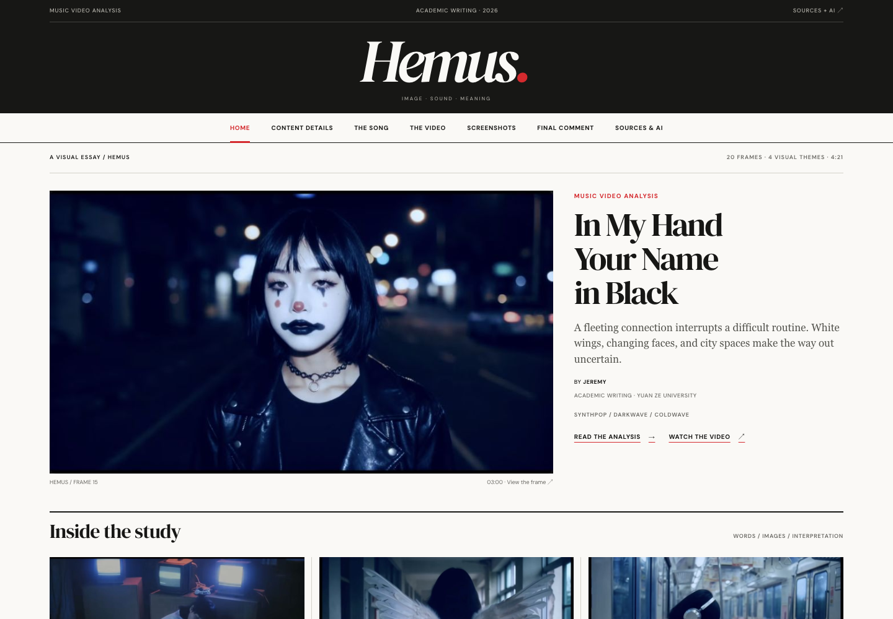
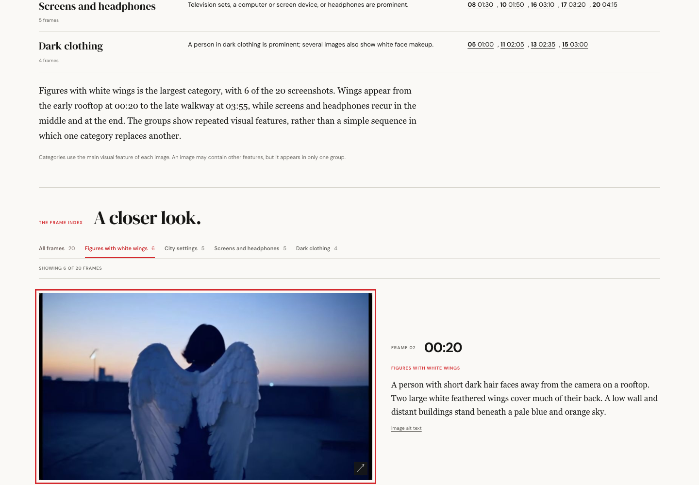

# HEMUS — Visual Study

An editorial-style, seven-page website for exploring the relationship between a music video’s images, sound, and written interpretation.

**Private portfolio archive.** Jeremy authorized a private source upload. The uploaded preparation copy omits the student identifier from both the home page and structured metadata. This remains an AI-assisted study and revision prototype containing third-party video frames, lyric quotations, and course details; public reuse and academic submission need separate review.



## Overview

The site presents a video study through linked articles, a categorized frame index, and an editable reflection. Its interface uses a publication-style masthead, serif headlines, restrained color, and full-aspect video stills. The local HTML edition was prepared as a reference for a later Google Sites version; it is not a native Google Sites project.

## Features

- Seven linked pages covering the introduction, content details, song, video, screenshot index, reflection, and sources/AI disclosure.
- A 20-frame gallery with category filters, visible result counts, timestamp links, and a native image dialog.
- Keyboard navigation between images, focus restoration after closing the dialog, and labelled controls.
- A reflection editor with live preview, word count, manual save, and copy support.
- Reflection and observation notes saved in the current browser using `localStorage`.
- A click-to-load video player using the `youtube-nocookie.com` embed endpoint.
- Mobile navigation, reduced-motion styling, and locally bundled fonts with license files.



*Authentic screenshots of the existing application captured during portfolio preparation. They reproduce third-party video frames and are included for private review.*

## Technology and architecture

| Layer | Implementation |
| --- | --- |
| Pages | Semantic HTML across seven static files |
| Styling | Shared CSS, responsive layouts, local DM Sans and DM Serif Display fonts |
| Interactions | Plain JavaScript and browser DOM APIs |
| Gallery | HTML frame records, category attributes, native dialog |
| Reflection storage | Browser `localStorage`; no server or account system |
| Video | YouTube iframe created after the reader selects Load Video |
| Build | No build step or package installation required |

```text
index.html               Home and project introduction
content-details.html     Video information and optional player
song.html                Song interpretation and lyric timing reference
video.html               Visual study and rhetorical analysis
screenshots.html         Categorized frame index and image dialog
reflection.html          Editable reflection and observation note
sources.html             Sources and AI-assistance disclosure
assets/
  css/styles.css         Shared editorial styling
  js/main.js             Navigation, gallery, reflection, and video interactions
  images/                Twenty selected frames from the third-party video
  fonts/                 Local fonts, source information, and OFL licenses
  content.json           Supplementary study metadata; student identifier omitted
```

The reviewed JavaScript reads the existing page elements directly. The site has no database, authentication, API backend, framework dependency, or runtime AI call. Saving a reflection changes browser storage; it does not modify the HTML or a Google Site.

## Run locally

Keep the folder structure intact and open `index.html` in a modern browser. For consistent browser storage, use Python 3 from the project folder:

```sh
python3 -m http.server 8000 --bind 127.0.0.1
```

Open `http://localhost:8000`. Local pages, fonts, and images do not require an external service. The optional video player and external source links require internet access.

## My role and AI-assisted development

Jeremy Budianto provided the project idea and product direction, learning from website references to decide what to build. **Codex** generated and revised the website implementation. This portfolio credits his concept and design direction without implying that he manually wrote the underlying code.

The project’s existing README and Sources/AI page also record substantial AI help with metadata research, frame capture, approximate timing, alt text, descriptions, categories, interpretation, rhetorical analysis, and reflection wording. The draft should not be presented as independently researched or independently written coursework. The source identifies a real third-viewing observation and replacement of sample wording with Jeremy’s own response as unfinished work.

## Verification and limits

Portfolio review checked the shared JavaScript and exercised the application in a browser:

- The gallery displayed 20 records and filtered a selected category to six frames.
- The image dialog opened and responded to keyboard navigation.
- A saved reflection remained available after reloading.
- Mobile navigation opened without page-level horizontal overflow.
- The shared script passed its syntax check; no JavaScript page errors were observed during those checks.

External network requests were blocked during browser review, so YouTube playback and external source availability were not verified. These checks do not certify full accessibility, cross-browser compatibility, or the accuracy of the study’s content. Lyric times are approximate, and interpretations and factual claims still need editorial review.

## Content, assets, and privacy

The video frames and lyric quotations come from third-party material and are not claimed as Jeremy’s original work. Confirm whether the intended portfolio use is permitted, or replace/remove that material. Screenshots also reproduce the frames. Preserve the bundled font license and source files when redistributing the fonts.

The student identifier is replaced with `[student ID omitted]` in the prepared home page and `assets/content.json`. Course/instructor details remain and should be reviewed before a public edition. The original local source is preserved unchanged.

No general open-source license has been selected for this mixed-content draft.

## Publication recommendation

**Keep this repository private.** A future public portfolio edition could demonstrate the editorial interface and browser interactions using cleared media, original sample writing, reviewed course/personal details, and accurate AI disclosure. The current private archive is not submitted coursework or a publicly licensed collection of music-video assets.
